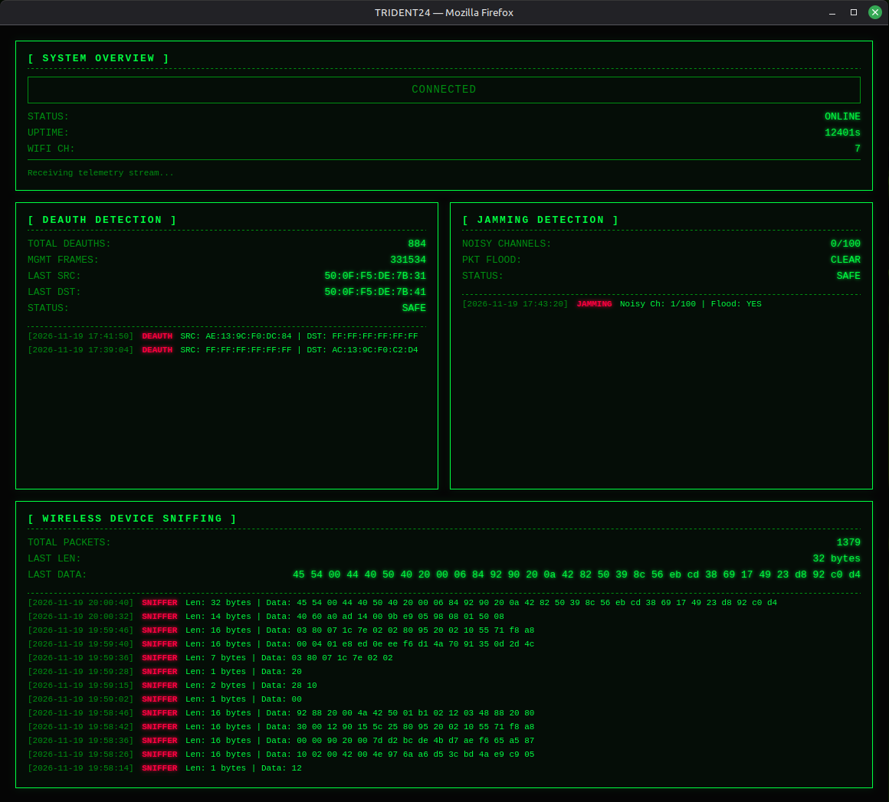
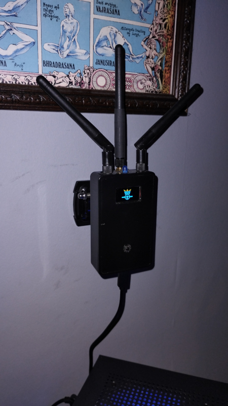

 

<h3 align="center">ESP32 TRIDENT24</h3>

---

## Summary
This project involves creating a defensive cybersecurity device using an ESP32 microcontroller that takes a three-pronged approach of passively scanning the 2.4 GHz wireless band. The purpose of which is to display and alert the user of any nearby WiFi activity that might potentially be malicious in nature.

## Background
The original concept was borne out of the desire to repurpose existing hardware that had been used in another project without modifying its wiring in any way, shape or form. Having previously built Emensta's original [ESP32-BlueJammer](https://github.com/EmenstaNougat/ESP32-BlueJammer) followed by his much more capable [BlueJammer-V2](https://github.com/EmenstaNougat/BlueJammer-V2), I wanted to use the original BlueJammer hardware to function as something else entirely without the need to take the whole thing apart (mainly because I had already Gorilla glued the circuitry into a project box). The construction of this device, then, is identical in nature to Emensta's original BlueJammer, however, I will reproduce the pinout in this documentation here, not just for clarity, but because I built the device on perfboard rather than use the premade DIY PCB shown in the original BlueJammer repo.

## Introduction
This project includes source code for a passive cybersecurity monitoring tool with the following requirements:

- <b>Deauth Detection</b>

  <i>Be able to detect potential nearby Deauthentication frames whereby a malicious actor may be attempting a type of denial-of-service attack in an effort to disrupt a specific WiFi network or sniff for a 4-way handshake.</i>

- <b>Jamming Detection</b>

   <i>Be able to detect the deliberate nearby blocking or interference of 2.4 GHz wireless communications.</i>

- <b>Device Sniffing</b>

  <i>Detect and obtain information of nearby WiFi devices operating on the 2.4 GHz band.</i>

## Hardware

Required:
- ESP32 Dev Module
- 2 x nRF24L01+PA+LNA Modules
- 2 x 10μF Capacitors
- 0.96" OLED Display I2C
- 220Ω or 330Ω Resistor
- Tactile Momentary Push Button
- Status LED
- 3 x 2.4 GHz SMA WiFi Antennas
- IPEX to SMA-F pigtail for Third Antenna

Additional:
- Perfboard
- Pin Headers

## Pinout

#### HSPI
| nRF24L01 Module 1       | HSPI (ESP32) | 10μF Capacitor |
|-------------------------|--------------|----------------|
| VCC                     | 3.3V         | +              |
| GND                     | GND          | -              |
| CE                      | GPIO 16      |
| CSN                     | GPIO 15      |
| SCK                     | GPIO 14      |
| MOSI                    | GPIO 13      |
| MISO                    | GPIO 12      |
| IRQ                     |              |

#### VSPI 
| nRF24L01 Module 2       | VSPI (ESP32) | 10μF Capacitor |
|-------------------------|--------------|----------------|
| VCC                     | 3.3V         | +              |
| GND                     | GND          | -              |
| CE                      | GPIO 22      |
| CSN                     | GPIO 21      |
| SCK                     | GPIO 18      |
| MOSI                    | GPIO 23      |
| MISO                    | GPIO 19      |
| IRQ                     |              |

#### Status LED
| ESP32   | Resistor          | Status LED |
|---------|-------------------|------------|
| GND     |                   | -          |
| GPIO 27 | 220Ω or 330Ω      | +          |

#### OLED Display
| 0.96" OLED Display | ESP32  |
|--------------------|--------|
| GND                | GND    |
| VCC                | 3.3V   |
| SCL                | GPIO 5 |
| SDA                | GPIO 4 |

#### Momentary Push Button
| Button Pin | ESP32   |
|------------|---------|
| 1          | GPIO 0  |
| 2          | GND     |

#### Third Antenna
| The 3rd antenna is plugged to the ESP32 chip itself, whether via IPEX or modded to attach an SMA-F |
|----------------------------------------------------------------------------------------------------|

## Installation
Flashing the ESP32:
1. Install **Arduino IDE** and add the ESP32 board support package:
   - Open **Arduino IDE**.
   - Go to **File > Preferences**.
   - In **Additional Board Manager URLs**, add:  
       https://raw.githubusercontent.com/espressif/arduino-esp32/gh-pages/package_esp32_index.json
   - Go to **Tools > Board > Board Manager** and install **esp32 by Espressif Systems**.

2. Install required libraries via the **Library Manager**:
   - **RF24** by TMRh20.
   - **Adafruit GFX Library** by Adafruit.
   - **Adafruit SSD1306** by Adafruit.

3. Download the **ESP32-Trident24** Repository and unzip the contents to the Arduino folder.
   - Open **Arduino IDE** and go to **File > Open**.
   - Select the downloaded main.ino file.

4. Compile and upload the code to your ESP32.

## Operation

#### Web UI
1. Connect the device by USB to a computer of laptop.
2. After the 3 second splash screen select option 1 "Web UI" (quick press to scroll, long press to select).
3. On the computer double click on the Trident24.html file located in the downloaded repository's "webui" folder.
4. When the browser opens click on the "CONNECT TO TRIDENT24 (USB)" option at the top of the page.
5. If asked whether to allow this file to access serial ports, select "Allow".

<i>Note: If using a Firefox based browser you will need to enable the Web Serial API prior to any of these instructions. To do so, open Firefox, type "about:config" in the address bar and accept the warning. Once done, search for "dom.webserial.enabled" and double click it to change its value to "true".</i>

#### Standalone
1. Connect the device by USB to a 5V DC power source (i.e. Power Bank, USB Hub/Charger or available USB Port).
2. After the 3 second splash screen select option 2 "Standalone" (quick press to scroll, long press to select).
3. The initial screen gives a basic summary of all systems being monitored. Press the button to scroll through the three detectors.

## Photos

#### Web UI

 

#### Device

 

 
 
