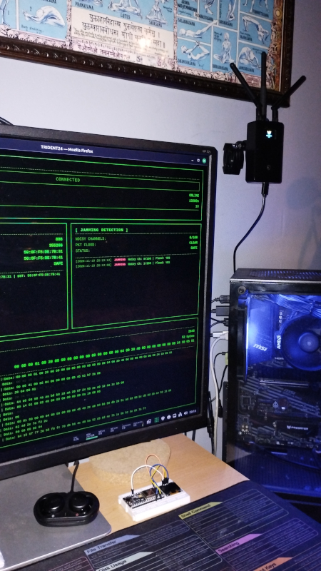

 

<h3 align="center">ESP32 TRIDENT24</h3>

---

# ***Note: Firmware & Documentation Still In Development***

## Summary

This project involves creating a defensive cybersecurity device using an ESP32 microcontroller that takes a three-pronged approach of passively scanning the 2.4 GHz wireless band. The purpose of which is to display and alert the user of any nearby WiFi activity that might potentially be malicious in nature.

## Background

The original concept was borne out of the desire to repurpose existing hardware that had been used in another project without modifying its wiring in any way, shape or form. Having previously built Emensta's original [ESP32-BlueJammer](https://github.com/EmenstaNougat/ESP32-BlueJammer) followed by his much more capable [BlueJammer-V2](https://github.com/EmenstaNougat/BlueJammer-V2), I wanted to use the original BlueJammer hardware to do something else without the need to take it apart (mainly because I had already epoxied the circuitry into a project box using 'Gorilla Glue Clear'). The construction of this device, then, is identical in nature to Emensta's original BlueJammer, however, I will reproduce the pinout and build instructions in this documentation here, not just for clarity, but because I built the device on perfboard rather than use the premade DIY PCB shown in the original BlueJammer repo.

## Introduction

## Hardware

Required:
- ESP32 Dev Module
- 2 x nRF24L01+PA+LNA Modules
- 10μF Capacitor
- 0.96" OLED Display I2C
- 220Ω or 330Ω Resistor
- Tactile Momentary Push Button
- Status LED
- 3 x 2.4 GHz Antennas
- IPEX to SMA-F pigtail for Third Antenna

Additional:
- Perfboard
- Pin Headers

## Pinout

#### HSPI
| nRF24L01 Module 1       | HSPI (ESP32) | 10μF Capacitor |
|-------------------------|--------------|----------------|
| VCC                     | 3.3V         | +              |
| GND                     | GND          | -              |
| CE                      | GPIO 16      |
| CSN                     | GPIO 15      |
| SCK                     | GPIO 14      |
| MOSI                    | GPIO 13      |
| MISO                    | GPIO 12      |
| IRQ                     |              |

#### VSPI 
| nRF24L01 Module 2       | VSPI (ESP32) | 10μF Capacitor |
|-------------------------|--------------|----------------|
| VCC                     | 3.3V         | +              |
| GND                     | GND          | -              |
| CE                      | GPIO 22      |
| CSN                     | GPIO 21      |
| SCK                     | GPIO 18      |
| MOSI                    | GPIO 23      |
| MISO                    | GPIO 19      |
| IRQ                     |              |

#### Status LED
| ESP32   | Resistor          | Status LED |
|---------|-------------------|------------|
| GND     |                   | -          |
| GPIO 27 | 220Ω or 330Ω      | +          |

#### OLED Display
| 0.96" OLED Display | ESP32  |
|--------------------|--------|
| GND                | GND    |
| VCC                | 3.3V   |
| SCL                | GPIO 5 |
| SDA                | GPIO 4 |

#### Button
| Button | ESP32   |
|--------|---------|
| 1      | GPIO 0  |
| 2      | GND     |

### Third Antenna
| The 3rd antenna is plugged to the ESP32 chip itself, whether via IPEX or modded to attach an SMA |
|--------------------------------------------------------------------------------------------------|

## Installation

## Operation

## Photos

#### Web UI

 

#### Device

 

 
 
